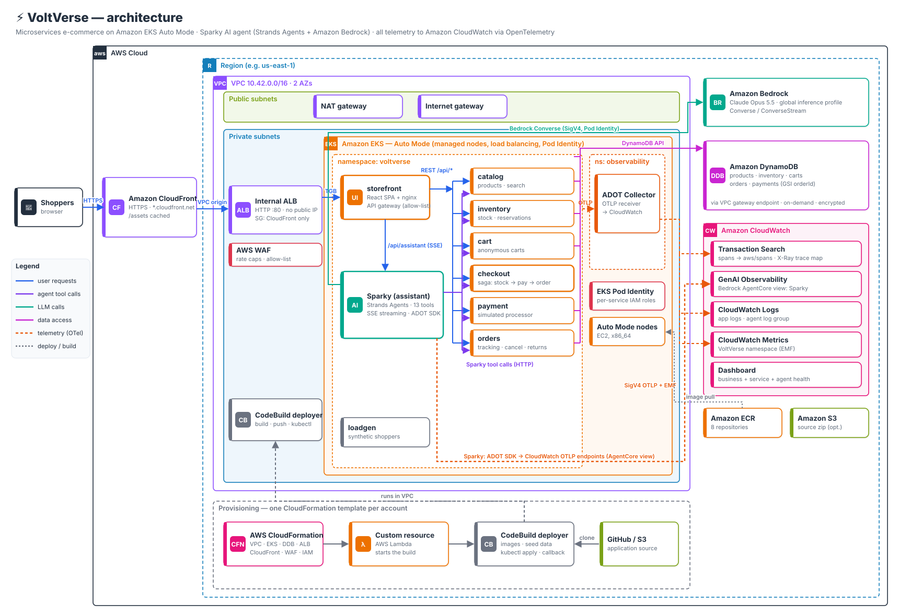

# ⚡ VoltVerse — *Electronics, energized.*

VoltVerse is a sleek, fully working electronics store built as a **microservices application on Amazon EKS**. It includes **Sparky**, an AI shopping and support assistant built with **Strands Agents** on **Amazon Bedrock**. Every component is instrumented with **OpenTelemetry**, and the microservices show up in **CloudWatch Application Signals** the same way they do in the [One Observability Demo](https://aws-samples.github.io/one-observability-demo/).

It is packaged as **one CloudFormation template**, so you can launch identical copies in many AWS accounts for workshops, demos, and observability training.



More diagrams (component overview, checkout and agent sequences, deployment flow) are in [docs/architecture.md](docs/architecture.md).

## What's inside

| Component | Tech | What it does |
|---|---|---|
| **storefront** | React 19 + Vite, nginx | Responsive SPA: home, category browsing, search, product pages, cart drawer, checkout, order tracking, and the Sparky chat widget. nginx is also the API gateway and exposes only an allow-list of public routes. |
| **catalog** | Python / FastAPI | 36 products in 10 categories, search, filters, sorting |
| **inventory** | Python / FastAPI | Live stock levels and **atomic reservations** (DynamoDB transactions) |
| **cart** | Python / FastAPI | Anonymous carts keyed by a browser UUID, with a 30-day TTL |
| **checkout** | Python / FastAPI | A saga that orchestrates pricing → reserve stock → authorize payment → create order → capture, and compensates on failure |
| **payment** | Python / FastAPI | Simulated card processor with test cards and fault injection. Stores only the card brand and last 4 digits. |
| **orders** | Python / FastAPI | Orders, simulated shipment tracking, cancellations (refund + restock), returns |
| **assistant** | Python / **Strands Agents** + Bedrock | **Sparky**: 13 tools, streaming replies (SSE), bounded agent loop |
| **loadgen** | Python | Continuous synthetic shoppers (page loads, browsing, search, carts, checkouts, cancellations), so dashboards and traces always have data. Never calls Bedrock. |
| **sparky-traffic** | Python | Continuous multi-turn conversations with Sparky through the storefront gateway, so GenAI Observability always has sessions. Calls Bedrock. |
| **CloudWatch Observability add-on** | CloudWatch agent, Fluent Bit, operator | Injects the ADOT Python SDK into annotated pods (**Application Signals**), plus **Container Insights** with enhanced observability and container logs |
| **otel-collector** | AWS Distro for OpenTelemetry | Receives the business metrics and OTLP logs. Forwards logs to the CloudWatch OTLP logs endpoint (SigV4), metrics to CloudWatch as EMF, and optionally to an external OTLP endpoint. |

### Sparky's tools

Each tool calls one microservice over HTTP, so agent reasoning, tool calls, and downstream service spans show up in **one distributed trace**.

| Tool | Service | | Tool | Service |
|---|---|---|---|---|
| `search_products` | catalog | | `get_order_status` | orders |
| `get_product_details` | catalog | | `cancel_order` | orders → inventory, payment |
| `list_categories` | catalog | | `request_return` | orders |
| `check_stock` | inventory | | `get_payment_status` | orders → payment |
| `view_cart` / `add_to_cart` / `update_cart_item` | cart | | `get_store_policies` | built-in knowledge |
| `get_checkout_quote` | checkout | | | |

Guardrails:
- The shopper's cart id is bound in code; the model never chooses it.
- Order tools require both the order number and the checkout email.
- IDs are validated before they are put into URLs.
- The agent asks for confirmation before cancellations and returns.
- Each request is capped at 10 model↔tool turns. A WAF rule and nginx rate limits cap Bedrock spend.

---

## Deploy

### Prerequisites

1. **An AWS Region that has:** EKS Auto Mode, CloudFront VPC origins, and your Bedrock model (for example `us-west-2` or `us-east-1`).
2. **Bedrock model access.** The default model is `global.anthropic.claude-opus-5-5`, a cross-region inference profile.
   - Anthropic models need a one-time *use-case form* per account. Submit it once in the Amazon Bedrock console, from the Anthropic model's page.
   - Confirm the ID is invocable: `aws bedrock list-inference-profiles --query "inferenceProfileSummaries[?contains(inferenceProfileId,'claude')].inferenceProfileId"`.
   - Use any other model or profile ID through the `BedrockModelId` parameter (for example `us.anthropic.claude-sonnet-5-5`).
3. **The source code must be reachable by CodeBuild.** Use one of:
   - **Public Git repo** (simplest): push this repo to GitHub and pass its HTTPS URL as `SourceRepoUrl`.
   - **S3 zip** (private repos, Workshop Studio): `scripts/package-source.sh <bucket>`, then set `SourceS3Bucket` / `SourceS3Key`.

### Option A — AWS Console

1. Open **CloudFormation → Create stack → With new resources**.
2. Upload `cloudformation/voltverse.yaml`.
3. Set `SourceRepoUrl` (or `SourceS3Bucket`). Leave everything else at defaults.
4. Tick **"I acknowledge that AWS CloudFormation might create IAM resources"** and create the stack.
5. After about 30 minutes, open the **`StorefrontUrl`** output.

### Option B — CLI

```bash
scripts/launch-stack.sh --repo https://github.com/<you>/voltverse.git
# or deploy from S3:
scripts/package-source.sh my-artifacts-bucket
scripts/launch-stack.sh --s3-bucket my-artifacts-bucket --s3-key voltverse-source.zip
```

### What happens during deployment

1. CloudFormation creates:
   - a VPC (2 AZs, single NAT), an EKS Auto Mode cluster, 5 DynamoDB tables, and 8 ECR repositories
   - the **Amazon CloudWatch Observability** EKS add-on (CloudWatch agent with its own Pod Identity role) and the Container Insights log groups
   - least-privilege Pod Identity roles, an internal ALB, a WAF web ACL, a CloudFront distribution with a VPC origin, and a CloudWatch dashboard
2. A custom resource starts the **CodeBuild deployer**, which runs inside the VPC. The deployer:
   - clones the source
   - enables CloudWatch Application Signals and Transaction Search in the account and region, if they're off
   - builds and pushes 8 images
   - seeds DynamoDB
   - waits for the add-on's auto-instrumentation webhook, then renders and applies `k8s/*.yaml` (including the two traffic generators)
   - checks that every annotated pod got the ADOT SDK injected
   - waits until the storefront is healthy behind the ALB
3. The build reports success or failure back to CloudFormation. If the deployment fails, the stack fails too, and the reason points at the CodeBuild build to inspect.

### Parameters

| Parameter | Default | Notes |
|---|---|---|
| `EnvironmentName` | `voltverse` | Prefix for all resource names. Must be unique per account and region. |
| `SourceRepoUrl` / `SourceBranch` | — / `main` | Public Git source |
| `SourceS3Bucket` / `SourceS3Key` | empty / `voltverse-source.zip` | S3 source. Overrides Git when set. |
| `BedrockModelId` | `global.anthropic.claude-opus-5-5` | Model or inference profile used by Sparky |
| `AssistantRequestsPer5Min` | `1000` | WAF cap on **total** assistant requests (Bedrock cost guard) |
| `ShopperTrafficPerMinute` | `12` | Synthetic shoppers per minute (`loadgen` pod). `0` disables it. |
| `AgentTrafficTurnsPerMinute` | `2` | Chat turns per minute sent to Sparky, continuously (`sparky-traffic` pod). **Every turn calls Bedrock.** `0` disables it. Max `10`. |
| `EnableTransactionSearch` | `true` | Enable CloudWatch Transaction Search in the account/region if it's off. Required for traces and the AgentCore view. |
| `ExternalOtlpEndpoint` | empty | Also send the microservices' business metrics and logs (and Sparky's metrics) to this OTLP/HTTP endpoint. Traces go to the CloudWatch agent. |
| `ParticipantRoleArn` | empty | IAM role granted EKS cluster-admin (for example a workshop participant role) |
| `EnablePublicClusterEndpoint` / `PublicEndpointCidrs` | `false` / empty | Expose the IAM-authenticated EKS API so `kubectl` works from laptops or CloudShell. Restrict it with CIDRs. |
| `AllowedViewerCidrs` | empty | Restrict the **store** to these CIDRs (WAF). Empty means public. |
| `KubernetesVersion` | empty (latest) | Pin an EKS version |
| `DeployVersion` | `1` | Change it and update the stack to rebuild and redeploy |

### Outputs

`StorefrontUrl`, `DashboardUrl`, `ApplicationSignalsUrl`, `ContainerInsightsUrl`, `GenAIObservabilityUrl`, `TraceMapUrl`, `ApplicationLogGroup`, `ContainerLogGroup`, `AgentLogGroup`, `ClusterName`, `KubeconfigCommand`, `DeployerProject`.

---

## Running workshops in many accounts

The template has no account-specific values. Pick whichever launch method fits your setup.

**1. A script per account or profile:**
```bash
for p in team-01 team-02 team-03; do
  AWS_PROFILE=$p AWS_REGION=us-west-2 scripts/launch-stack.sh --repo https://github.com/<you>/voltverse.git &
done; wait
```

**2. CloudFormation StackSets (AWS Organizations, service-managed):**
```bash
aws cloudformation create-stack-set --stack-set-name voltverse \
  --template-body file://cloudformation/voltverse.yaml \
  --capabilities CAPABILITY_IAM --permission-model SERVICE_MANAGED \
  --auto-deployment Enabled=false \
  --parameters ParameterKey=SourceRepoUrl,ParameterValue=https://github.com/<you>/voltverse.git

aws cloudformation create-stack-instances --stack-set-name voltverse \
  --deployment-targets OrganizationalUnitIds=ou-xxxx-workshop --regions us-west-2 \
  --operation-preferences MaxConcurrentPercentage=100,FailureTolerancePercentage=10
```

**3. AWS Workshop Studio:** see [docs/workshop-studio.md](docs/workshop-studio.md) for a `contentspec.yaml` example. It shows the template and source zip as workshop assets, and the participant role passed through `ParticipantRoleArn`.

Notes for workshop operators:
- **Bedrock access is per account.** Submit the Anthropic use-case form in each account, or use the account vending process your event platform provides, before the event.
- **Cost (estimate, verify with the AWS Pricing Calculator):** roughly **US$0.45–0.70 per account per hour** while running. That covers EKS, Auto Mode nodes, NAT, ALB, WAF, and CloudWatch. Bedrock is extra and depends on usage: the `sparky-traffic` pod calls it around the clock (`AgentTrafficTurnsPerMinute`, default 2 turns/minute). Delete stacks after the event.
- **Default quotas:** each account needs 1 EIP, 1 NAT gateway, 1 VPC, and 1 CloudFront distribution.

---

## Using the store

- **Test cards** (no real payments):

  | Card | Result |
  |---|---|
  | `4242 4242 4242 4242` | Approved |
  | `4000 0000 0000 0002` | Declined |
  | `4000 0000 0000 9995` | Insufficient funds |
  | `4000 0000 0000 0119` | Processor error (HTTP 502) |

- **Order tracking:** orders move CONFIRMED → PROCESSING (2 min) → SHIPPED (10 min) → OUT FOR DELIVERY (30 min) → DELIVERED (60 min). Express shipping is twice as fast. Orders can be cancelled until they ship.
- **Try Sparky:**
  - *"I need noise-cancelling headphones under $400"*
  - *"Compare the Nova X1 and X1 Pro"*
  - *"Add two Pulse Buds Pro 2 to my cart"*
  - *"What's my total with express shipping?"*
  - *"Where is order VV-XXXXXXXX? my email is …"*
  - *"Cancel it"*

## Observability

Everything uses **OpenTelemetry**, and all logs, metrics, and traces land in **Amazon CloudWatch**. The setup follows the [One Observability Demo](https://github.com/aws-samples/one-observability-demo):
- The stack installs the **Amazon CloudWatch Observability EKS add-on**. It runs the CloudWatch agent (Pod Identity role with `CloudWatchAgentServerPolicy`) and Fluent Bit, and turns on **Container Insights** with enhanced observability.
- Each microservice pod (and `loadgen`) has the annotation `instrumentation.opentelemetry.io/inject-python: "true"`. The add-on's operator injects the **ADOT Python SDK** at pod start. The images contain only the OpenTelemetry API. The services then show up in **CloudWatch Application Signals** (`eks:<cluster>/voltverse`) with a service map, latency, fault and error metrics per operation, SLOs, and traces.
- The injected SDK sends traces and Application Signals metrics to the CloudWatch agent. The `voltverse-otel` ConfigMap also sends the business metrics (`voltverse.*`) and OTLP logs to the in-cluster ADOT Collector. The collector writes metrics as EMF and logs to the **CloudWatch OTLP logs endpoint**.
- **Sparky** is configured as a GenAI agent for **CloudWatch GenAI Observability → Bedrock AgentCore**. AgentCore doesn't support agents that export through a collector, so Sparky bundles the ADOT SDK (`AGENT_OBSERVABILITY_ENABLED=true`), opts out of injection, and sends its spans and logs directly to CloudWatch. It uses the agent log group `/aws/bedrock-agentcore/runtimes/<env>-sparky` and propagates `session.id`. Sparky's metrics go through the collector.
- Strands emits GenAI semantic-convention spans for agent invocations, event-loop cycles, model calls, and tool calls.
- **Application Signals** and **CloudWatch Transaction Search** are account- and region-level settings. The deployer turns them on if they're off (`EnableTransactionSearch`, default `true`). They stay on when the stack is deleted.

| Signal | Where |
|---|---|
| Services | **CloudWatch → Application Signals** (`ApplicationSignalsUrl`): service map, per-operation latency, faults, and errors, dependencies (DynamoDB, downstream services), SLOs |
| Cluster | **CloudWatch → Container Insights** (`ContainerInsightsUrl`): cluster, node, pod, and container metrics. Container stdout is in `ContainerLogGroup`. |
| Traces | **CloudWatch → Transaction Search** (spans in `aws/spans`; query any span attribute, e.g. `voltverse.order.id`, `session.id`) and the trace map (`TraceMapUrl`) |
| AI agent | **CloudWatch → GenAI Observability → Bedrock AgentCore** (`GenAIObservabilityUrl`): Sparky's sessions, traces, model and tool spans, token usage, latency, and errors. Logs are in `AgentLogGroup`. | Searchable annotations: `voltverse.order.id`, `voltverse.checkout.outcome`, `voltverse.payment.status`, `session.id`. |
| Metrics | CloudWatch namespaces **`ApplicationSignals`** and **`VoltVerse`**, and the `DashboardUrl` dashboard: latency, requests and faults per service, checkout outcomes, revenue, payment outcomes, agent latency, tool usage, and `gen_ai.*` token usage |
| Logs | `ApplicationLogGroup` (microservices, via the OTLP logs endpoint) and `AgentLogGroup` (Sparky). Every record carries the trace and span ids for log↔trace correlation. |
| Anything else | Set `ExternalOtlpEndpoint`, or edit `k8s/10-otel-collector.yaml` |

**Traffic generators:** two pods run continuously:
- `loadgen`: shoppers (`ShopperTrafficPerMinute`)
- `sparky-traffic`: Sparky conversations (`AgentTrafficTurnsPerMinute`)

Change the parameters and update the stack, or scale a pod directly: `kubectl -n voltverse scale deploy/sparky-traffic --replicas=0`.

**Extra Sparky traffic:** `scripts/sparky-traffic.py <StorefrontUrl> --minutes 15 --rate 8` (the same script the pod runs) runs realistic multi-turn conversations: recommendations, comparisons, cart changes, quotes, order tracking, cancellations, payments, policies, and off-topic requests. It creates real orders for the order scenarios first. Every turn calls Bedrock, so mind the cost. The gateway allows about 12 assistant requests per minute per IP.

**Fault injection** for exercises is in the `voltverse-chaos` ConfigMap:

```bash
kubectl -n voltverse patch configmap voltverse-chaos -p '{"data":{"PAYMENT_FAILURE_RATE":"0.3","PAYMENT_LATENCY_MS":"1500"}}'
kubectl -n voltverse rollout restart deploy/payment
```

The ConfigMap also has `CHAOS_LATENCY_MS` / `CHAOS_ERROR_RATE` (applied to every service) and `ORDER_TIMELINE_SCALE`. See [docs/workshop-guide.md](docs/workshop-guide.md) for guided labs.

---

## Run Sparky standalone

Sparky can also run **on its own**, without EKS, a VPC or DynamoDB, and still hold meaningful shopping and support conversations:
- With `SPARKY_BACKEND=embedded`, Sparky starts the **real** catalog, inventory, cart, checkout, payment and orders services inside its own container. They run against an in-memory DynamoDB emulator (moto), so tools and business rules behave exactly as on EKS.
- The store is seeded with the catalog and **demo orders in every state**: just placed, processing, shipped, out for delivery, delivered (returnable), delivered (return window closed), and cancelled and refunded.
- It implements the **Bedrock AgentCore Runtime** contract: `GET /ping`, and `POST /invocations` with `{"prompt": ...}`, `{"action": "demo_data"}` or `{"action": "reset"}`. The conversation and cart are kept per runtime session.
- **Simulated shoppers** (`scripts/sparky_shopper.py`) hold unscripted conversations with it. A smaller model (default `global.anthropic.claude-haiku-5-5`) role-plays one of 15 personas with a goal: comparing laptops, building a cart, chasing a late order, cancelling, returning, checking a refund, off-topic requests, and more. Each conversation logs one JSON line with the persona, outcome, turns and tools used.

**Run it locally** (needs only Bedrock access):
```bash
docker build -f services/sparky-standalone.Dockerfile -t sparky-standalone .        # from the repo root
eval "$(aws configure export-credentials --format env)"                             # short-lived credentials
docker run --rm -p 127.0.0.1:8080:8080 -e AWS_REGION=us-east-1 -e OTEL_SDK_DISABLED=true \
  -e AWS_ACCESS_KEY_ID -e AWS_SECRET_ACCESS_KEY -e AWS_SESSION_TOKEN sparky-standalone

curl -s -X POST http://127.0.0.1:8080/invocations -H 'Content-Type: application/json' \
  -H 'X-Amzn-Bedrock-AgentCore-Runtime-Session-Id: my-session-0123456789abcdefghijklmnop' \
  -d '{"prompt": "I need noise cancelling headphones under $400"}'
scripts/sparky_shopper.py --url http://127.0.0.1:8080 --conversations 3 --verbose   # simulated shoppers
```

**Deploy it to AWS** with `cloudformation/sparky-standalone.yaml`. Set the same `SourceRepoUrl` or `SourceS3Bucket`/`SourceS3Key` source parameters as the main stack. The stack creates:
- an ECR repository, and an ARM64 CodeBuild project that builds and smoke-tests the images
- Sparky on **Bedrock AgentCore Runtime** (public network mode, Bedrock-only IAM role)
- the shopper simulator as an arm64 Lambda, run every 10 minutes by EventBridge (`ConversationsPer10Min`, default 1, `0` = off)

Sparky then appears in **CloudWatch GenAI Observability → Bedrock AgentCore**. The `ChatCommand` output chats with it from a terminal. It's fully separate from the EKS stack: its own name (`voltverse_sparky`), role, repository and logs. It does share the account's Bedrock quotas with the EKS Sparky. Both sides of every simulated turn call Bedrock, and the AgentCore runtime log group isn't deleted with the stack.

## Local development

```bash
# Whole stack on http://127.0.0.1:8080 (Docker or Finch). Only the storefront port is published, on loopback.
docker compose -f local/docker-compose.yml up --build      # or: finch compose ...
# Sparky locally needs Bedrock credentials from ~/.aws (set AWS_PROFILE).

# Integration tests: every service runs on 127.0.0.1 against moto-emulated DynamoDB. No AWS account needed.
python3.12 -m venv .venv && . .venv/bin/activate && pip install -r tests/requirements.txt
pytest -q tests

# Frontend hot reload (proxies /api to the compose stack)
cd services/storefront && npm install && npm run dev
```

## Updating, redeploying and cleaning up

- **Redeploy after code changes:**
  - Push to the branch (or re-upload the zip).
  - Then either update the stack with a new `DeployVersion`, or click **Start build** on the `DeployerProject` CodeBuild project.
- **Delete:** `aws cloudformation delete-stack --stack-name voltverse`. A destroy build removes the Kubernetes workloads first, then CloudFormation deletes everything else, including ECR images, tables, and log groups. Deletion takes about 20 minutes, because CloudFront has to be disabled first.

## Security notes

- **Public by design:** the storefront is an anonymous retail site, like any web shop. Customer-specific data is protected:
  - Carts are keyed by unguessable UUIDs.
  - Orders require the order number **and** the checkout email.
  - Lookups don't reveal whether an order exists.

  Set `AllowedViewerCidrs` to restrict the whole store to your workshop network.
- **Single entry point:** CloudFront (HTTPS) → VPC origin → **internal** ALB, whose security group admits only CloudFront's VPC-origin security group. Nothing in the VPC has a public IP except the NAT gateway.
- **Internal-only APIs:** nginx exposes an allow-list of routes. Payment, restock, reservation, and order-creation APIs are reachable only inside the cluster.
- **EKS API endpoint:** private by default. The deployer runs inside the VPC.
- **Pods:**
  - Each workload has its own least-privilege IAM role through EKS Pod Identity.
  - Pods run as non-root with read-only root filesystems and all capabilities dropped (the `restricted` Pod Security Standard controls). The `voltverse` namespace enforces `baseline` and warns/audits on `restricted`, because the add-on's injected init container has no container `securityContext`.
- **Data at rest:** DynamoDB tables are encrypted. ECR images are scanned on push. The payment service never stores card numbers or CVCs.
- **No authentication:** this is a demo store with no customer accounts. Don't put real personal or payment data in it.

## Troubleshooting

| Symptom | Fix |
|---|---|
| Stack fails at `Deployment` | Open the CodeBuild project `<env>-deployer` and read the latest build log. Common causes: a wrong `SourceRepoUrl` or branch, or a private repo (use the S3 source instead). |
| Sparky says it's "taking a short break" | Bedrock access isn't enabled, or the model ID isn't available in the region. Check the `assistant` logs in `ApplicationLogGroup` (search for `agent invocation failed`). |
| HTTP 429 from the store | nginx per-viewer rate limits (`services/storefront/nginx.conf`) or the WAF assistant cap |
| A service is missing from Application Signals | Check that its pods have the `opentelemetry-auto-instrumentation-python` init container: `kubectl -n voltverse get pod -l app=catalog -o jsonpath='{.items[0].spec.initContainers[*].name}'`. If they don't, check the `amazon-cloudwatch-observability` add-on's health in the EKS console, then run `kubectl -n voltverse rollout restart deploy`. New services appear a few minutes after their first requests. |
| `kubectl` times out | The EKS endpoint is private by default. Set `EnablePublicClusterEndpoint=true` (plus `PublicEndpointCidrs`), or use a CloudShell VPC environment in the stack's VPC. |

## Repository layout

```
cloudformation/voltverse.yaml   # the one template to launch everything
cloudformation/sparky-standalone.yaml  # optional: Sparky alone on Bedrock AgentCore Runtime + simulated shoppers
k8s/                            # Kubernetes manifests (rendered by scripts/render.py at deploy time)
services/
  common/                       # shared FastAPI app factory, logging, DynamoDB + HTTP helpers, requirements
  python.Dockerfile             # one image definition for all Python services (ADOT SDK injected on EKS)
  sparky-standalone.Dockerfile  # standalone Sparky with the embedded store (arm64-ready, build from repo root)
  sparky-shopper.Dockerfile     # Lambda image for the shopper simulator
  catalog/ inventory/ cart/ checkout/ payment/ orders/ assistant/
  storefront/                   # React app, nginx gateway config, Dockerfile
  loadgen/                      # synthetic shopper traffic (loadgen pod)
scripts/                        # deploy/destroy (CodeBuild), seeding, rendering, packaging, launch helpers,
                                #   sparky-traffic.py (AI assistant traffic, sparky-traffic pod),
                                #   sparky_shopper.py (LLM-simulated shoppers for standalone Sparky)
data/products.json              # catalog seed data
local/                          # docker-compose stack for local development
tests/                          # end-to-end integration tests
docs/                           # architecture, workshop guide, Workshop Studio notes
```

## License

MIT-0. See [LICENSE](LICENSE). Product names and brands in the catalog are fictional.
