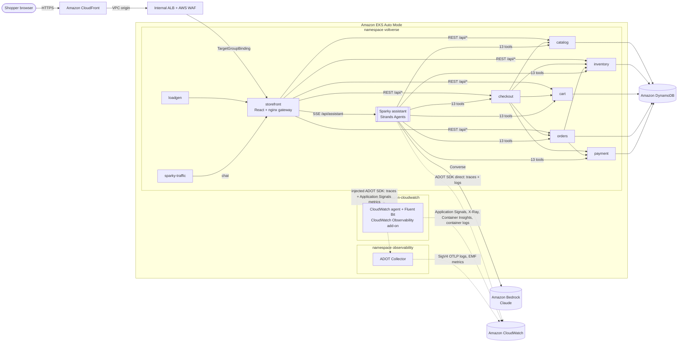
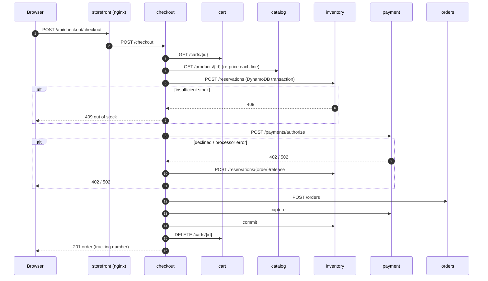
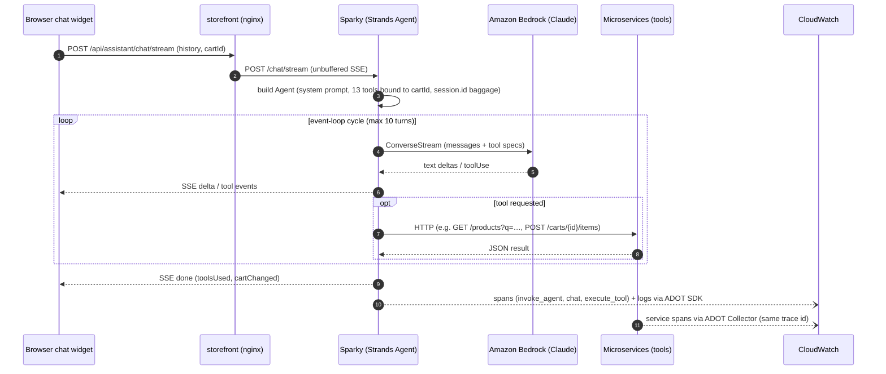
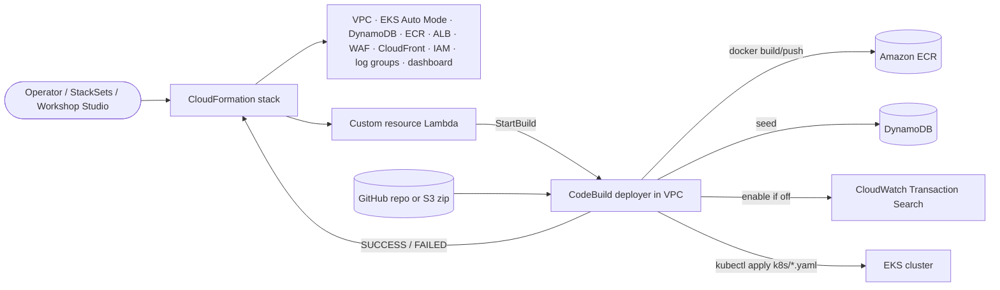

# VoltVerse architecture


*High-resolution PNG: [images/voltverse-architecture.png](images/voltverse-architecture.png). Regenerate with `python3 docs/images/generate_architecture.py docs/images/voltverse-architecture.svg`.*

## Component overview



## Sequence: placing an order



## Sequence: one Sparky turn



## Deployment flow



## Request path

```
viewer ──HTTPS──► CloudFront ─┬─ /assets/*  cached (CachingOptimized)
                              └─ everything else: no cache, all viewer headers + CloudFront-Viewer-Address
                                   │ VPC origin (private ENIs in the VPC)
                                   ▼
                    internal ALB (private subnets, SG: tcp/80 only from CloudFront-VPCOrigins-Service-SG, WAF attached)
                                   │ target group (type ip) ◄── TargetGroupBinding (EKS Auto Mode)
                                   ▼
                    storefront pods: nginx serves the SPA and proxies an allow-list of /api routes
```

The ALB is never internet-facing. CloudFront reaches it through a **VPC origin**, so CloudFront is the only public entry point, and it uses the default `*.cloudfront.net` certificate (no domain needed).

The ALB, its target group and listener are **created by CloudFormation**. Kubernetes only *binds* pods into the target group with a `TargetGroupBinding`. This avoids the usual chicken-and-egg problem where CloudFront would need the DNS name of a load balancer that Kubernetes hasn't created yet, and it lets the whole stack be one template.

### Public API surface (nginx allow-list)

| Public route | Upstream | Methods |
|---|---|---|
| `/api/catalog/categories`, `/api/catalog/products[/{id}]` | catalog | GET |
| `/api/inventory/stock?ids=` | inventory | GET |
| `/api/cart/carts/{uuid}[/items[/{id}]]` | cart | GET, POST, PUT, DELETE |
| `/api/checkout/quote`, `/api/checkout/checkout` | checkout | GET, POST |
| `/api/orders/orders/{id}[/cancel]` | orders | GET, POST (email required) |
| `/api/assistant/chat[/stream]` | assistant | POST |

Anything else under `/api/` returns 404 at the gateway. Payment, `POST /orders`, `/reservations*` and `/restock` are reachable only inside the cluster.

## Checkout saga

```
checkout ─► cart (load) ─► catalog (re-price every line)
         ─► inventory POST /reservations         (DynamoDB TransactWriteItems: all-or-nothing)
         ─► payment  POST /payments/authorize    ── fail ─► inventory release
         ─► orders   POST /orders                ── fail ─► payment refund + inventory release
         ─► payment capture, inventory commit, cart clear   (best effort, logged)
```

Cancelling an order (`orders`) releases the reservation in `inventory` and refunds the payment in `payment`.

## Data model (DynamoDB, on-demand)

| Table | Key | Notes |
|---|---|---|
| `<env>-products` | `productId` | Seeded from `data/products.json` on every deploy (upsert) |
| `<env>-inventory` | `pk` | `SKU#<id>` → `{available, reserved}`; `RES#<orderId>` → reservation state. Stock is only seeded when missing. |
| `<env>-carts` | `cartId` | TTL attribute `expiresAt` (30 days) |
| `<env>-orders` | `orderId` | Fulfilment status is derived from the order age |
| `<env>-payments` | `paymentId` | GSI `orderId-index` |

## Sparky (Strands agent)

- **Statelessness:** the browser sends the visible conversation on every turn, and the service builds a fresh `Agent` per request with `messages=` history. Any replica can answer and nothing is stored server-side.
- **Per-request tools:** tools are created per request by `build_tools(cart_id, ...)`, so the cart id is captured in a closure and never exposed to the model.
- **Streaming:** `POST /chat/stream` returns Server-Sent Events (`tool`, `delta`, `done`, `error`) and sends heartbeat comments every 10 s. These keep CloudFront's 60 s origin read timeout from firing while tools run.
- **Limits:** `limits={"turns": 10}` caps model↔tool cycles. `max_tokens=4096` caps each response.
- **Model:** `BedrockModel(model_id=BEDROCK_MODEL_ID)` via the Bedrock Converse API. IAM allows `bedrock:InvokeModel*` on foundation models and the account's inference profiles.

## Telemetry pipeline (everything lands in Amazon CloudWatch)

```
Amazon CloudWatch Observability EKS add-on (namespace amazon-cloudwatch, CloudWatch agent with Pod Identity)
   ├─ operator webhook: pods annotated instrumentation.opentelemetry.io/inject-python: "true" get an init container
   │  that copies the ADOT Python SDK into the pod; PYTHONPATH + OTEL_* env vars start it (no SDK in the image)
   ├─ CloudWatch agent DaemonSet: Container Insights (enhanced observability) + Application Signals receiver
   └─ Fluent Bit DaemonSet: container stdout/stderr → /aws/containerinsights/<cluster>/application

microservice + loadgen pods (injected ADOT SDK: FastAPI, httpx, botocore, logging, Python runtime metrics)
   ├─ traces + Application Signals metrics → cloudwatch-agent.amazon-cloudwatch:4316
   │     → X-Ray / aws/spans (Transaction Search), ApplicationSignals namespace, service map, SLOs
   └─ business metrics (voltverse.*) + OTLP logs → http://otel-collector.observability:4318   (voltverse-otel ConfigMap)

ADOT collector ─ memory_limiter → resource(cloud.*, k8s.cluster.name) → batch
   ├─ logs    → otlphttp + sigv4auth → https://logs.<region>.amazonaws.com/v1/logs   → ApplicationLogGroup
   ├─ metrics → awsemf (namespace VoltVerse; dimension sets allow-listed to control cardinality)
   ├─ traces  → otlphttp + sigv4auth → https://xray.<region>.amazonaws.com/v1/traces (for OTLP senders other than the agent)
   └─ (optional) otlphttp/external → ExternalOtlpEndpoint

Sparky pod (ADOT SDK, AGENT_OBSERVABILITY_ENABLED=true, Strands GenAI spans, session.id baggage)
   ├─ traces  → SigV4 → https://xray.<region>.amazonaws.com/v1/traces  ─┐  CloudWatch GenAI Observability
   ├─ logs    → SigV4 → https://logs.<region>.amazonaws.com/v1/logs    ─┤  → Bedrock AgentCore view
   │                                                                     ┘  (/aws/bedrock-agentcore/runtimes/<env>-sparky)
   └─ metrics → OTLP → collector → EMF, VoltVerse namespace (allow-listed dimensions)
```

Why Sparky bypasses the collector: AgentCore observability for agents hosted outside the AgentCore runtime requires the ADOT SDK (or the ADOT Lambda layer). The ADOT Collector isn't supported for agent telemetry. W3C/X-Ray trace context still propagates on Sparky's tool calls, so its spans and the microservice spans share one trace id.

CloudWatch Transaction Search must be enabled in the account and region, because the OTLP traces endpoint stores spans in `aws/spans`. The deployer enables it when it's off (resource policy for X-Ray on `aws/spans`, then `UpdateTraceSegmentDestination=CloudWatchLogs`).

All configuration uses `OTEL_*` variables: `voltverse-otel` (injected services) and `sparky-otel` in `k8s/20-config.yaml`, and Sparky's overrides in `k8s/30-services.yaml`. The operator never overrides a variable that is already set, so `voltverse-otel` only adds what Application Signals doesn't cover. It sets `OTEL_AWS_APPLICATION_SIGNALS_ENABLED=true` explicitly: without it, the operator skips injection when any OTLP endpoint points somewhere other than the CloudWatch agent. Application code only uses the OpenTelemetry API.

The injected init container has no container `securityContext`, so the `voltverse` namespace enforces the `baseline` Pod Security Standard and warns/audits on `restricted`. Every VoltVerse container still sets the restricted controls itself.

## IAM (EKS Pod Identity)

| Service account | Permissions |
|---|---|
| catalog | `dynamodb:Scan/GetItem/Query` on products |
| inventory | `GetItem/BatchGetItem/PutItem/UpdateItem/ConditionCheckItem` on inventory |
| cart | `GetItem/PutItem/DeleteItem` on carts |
| orders | `GetItem/PutItem/UpdateItem` on orders |
| payment | `GetItem/PutItem/UpdateItem/Query` on payments (+ GSI) |
| assistant (Sparky) | `bedrock:InvokeModel*`; `AWSXrayWriteOnlyAccess`; CloudWatch Logs writes to the agent log group |
| otel-collector | `AWSXrayWriteOnlyAccess`; CloudWatch Logs writes to the VoltVerse application and metrics log groups |
| cloudwatch-agent (add-on) | `CloudWatchAgentServerPolicy`, `AWSXrayWriteOnlyAccess` |
| checkout, storefront, loadgen, sparky-traffic | none (no AWS API calls) |

## Deployment mechanics

`Custom::VoltVerseDeployment` → Lambda `StartBuild` → CodeBuild (inside the VPC, privileged for Docker):

1. Fetch the source from Git or the S3 zip.
2. Run `scripts/codebuild-deploy.sh`:
   - install a kubectl version that matches the cluster
   - build and push images (tag `b<build number>`)
   - enable Application Signals (`StartDiscovery`) and Transaction Search
   - seed DynamoDB
   - wait for the CloudWatch Observability add-on's webhook
   - create the traffic-script ConfigMaps from their files, then run `scripts/render.py k8s/*.yaml | kubectl apply -f -`
   - wait for rollouts, check that every annotated pod got the ADOT init container (restart once if not), and wait for healthy ALB targets
3. PUT the result to the CloudFormation pre-signed response URL.

On stack deletion the same path runs `scripts/codebuild-destroy.sh`, which always reports success, so a broken cluster never blocks teardown.
